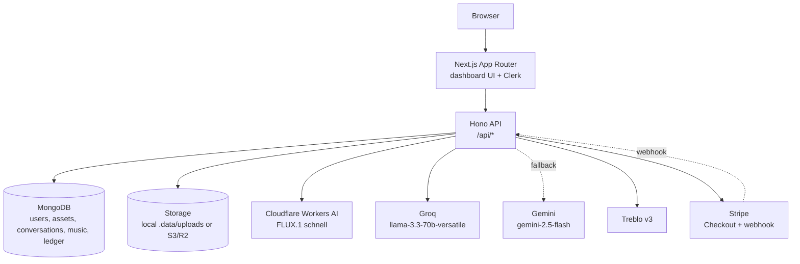

# Vision

An AI creative studio that puts image generation, conversation, and music generation in one workspace. Built as a full-stack Next.js application with a Hono API, MongoDB persistence, Clerk authentication, and Stripe billing.


Deployed preview: [vision-steel-pi.vercel.app](https://vision-steel-pi.vercel.app) (Clerk-protected; the deployment may lag the default branch).

## Status at a glance

| Surface | State today |
| --- | --- |
| Dashboard | Generation entry points, credit usage, plan, and recent activity |
| Image generation | Cloudflare Workers AI FLUX.1 schnell, 1–2 images per request, private storage; prompt examples, ratio tiles, cost label, retryable error states |
| Theming | Light, dark, and system toggle in the navbar (`next-themes`, token-driven) |
| Conversation | Groq `llama-3.3-70b-versatile` with Gemini `gemini-2.5-flash` fallback |
| Music generation | Treblo v3, stored as a playable audio asset |
| Video generation | Not available — no provider is configured or integrated |
| Free plan quota | 5 generations per account, enforced server-side |
| Pro upgrade | Stripe Checkout; the webhook flips the plan to PRO |

Each generation request consumes one quota unit (an image request for two images is still one unit). Without real provider keys the app runs in **mock mode** locally so every screen can be exercised end to end.

## Architecture



A generation request flows through: Clerk session → Zod validation → quota reservation → provider call → object storage → asset metadata in MongoDB → quota settlement. Provider failures refund the reservation; a replayed idempotency key returns `409 DUPLICATE_REQUEST` instead of charging again.

## Quick start

Prerequisites: Node.js 20+ (or Bun 1.4+), Docker for the local database, and a Clerk application.

```bash
git clone https://github.com/ni3420/vision.git
cd vision
bun install

cp .env.example .env.local
# edit .env.local: Clerk keys and NEXT_PUBLIC_APP_URL
# DB_URL already points at the compose service

docker compose up -d      # MongoDB 7 on 127.0.0.1:27017
bun run dev
```

`docker compose down` stops the database and keeps its data in the `mongo-data` volume; add `-v` to delete the data too. The service is bound to `127.0.0.1` only, so it is not exposed to the network.

Open `http://localhost:3000`, sign up, and generate an image. The dashboard's `UserSync` component creates the MongoDB user on first load; quota checks need that record.

### Environment variables

The complete list with comments lives in [`.env.example`](.env.example).

| Group | Variables | Needed |
| --- | --- | --- |
| Database | `DB_URL` | Always |
| Auth | `NEXT_PUBLIC_CLERK_PUBLISHABLE_KEY`, `CLERK_SECRET_KEY` | Always |
| App | `NEXT_PUBLIC_APP_URL` | Always (Stripe redirects) |
| Runtime mode | `AI_MODE` (`auto` \| `live` \| `mock`) | Optional, defaults to `auto` |
| Image provider | `CLOUDFARE_URL` + `CLOUDFARE_API_KEY`, or `CLOUDFLARE_ACCOUNT_ID` + `CLOUDFLARE_API_TOKEN` | For live images |
| Chat provider | `GROQ_API_KEY`, `GROQ_MODEL`, `GEMINI_API_KEY`, `GEMINI_MODEL` | For live chat |
| Music provider | `TREBLO_API_KEY` | For live music |
| Storage | `STORAGE_DRIVER` (`local` \| `s3` \| `imagekit`), `LOCAL_STORAGE_DIR`, `S3_*`, `IMAGEKIT_URL_ENDPOINT`, `IMAGEKIT_PUBLIC_KEY`, `IMAGEKIT_PRIVATE_KEY`, `IMAGEKIT_PRIVATE_FILES` | Local by default |
| Billing | `STRIPE_SECRET_KEY`, `NEXT_PUBLIC_STRIPE_PRO_PRICE_ID`, `STRIPE_WEBHOOK_SECRET` | For checkout |

### Mock mode

`AI_MODE=auto` (default) calls a provider when its key looks real; otherwise it renders a local mock outside production. Mock output is visibly labelled in the UI (`Local mock preview`, `[dev mock reply]`) and is never presented as real output. The mocks are:

- **Image** — a locally rendered gradient card with the prompt, resized with `sharp`.
- **Chat** — a canned reply that repeats the prompt.
- **Music** — a synthesized WAV chord, capped at 20 seconds.

In production, missing keys resolve to `live` and return `503 PROVIDER_NOT_CONFIGURED` instead of silently faking output.

### Storage

- `STORAGE_DRIVER=local` writes to `.data/uploads` (git-ignored) and serves files from `GET /api/assets/:key`, which requires the owning Clerk session.
- `STORAGE_DRIVER=s3` works with AWS S3, Cloudflare R2, and **Backblaze B2** (`S3_ENDPOINT=https://s3.<region>.backblazeb2.com`, `S3_REGION=<region>`); reads return short-lived presigned URLs.
- `STORAGE_DRIVER=imagekit` uploads server-side to ImageKit and stores the durable CDN URL on the asset, so history never depends on a URL that expires. Set `IMAGEKIT_PRIVATE_FILES=true` to upload private files, which are served with signed `ik-t`/`ik-s` URLs instead.

Object keys are opaque (`users/<userId>/<kind>/<yyyy>/<mm>/<uuid>.<ext>`) and ownership is re-checked on every read. Generated images are stored with their URL in `assets.url`; presigned or signed URLs are never persisted.

Image provider calls retry up to 3 times with exponential backoff on network errors and `408`/`429`/`5xx`; `Retry-After` is honoured. A failed request returns `retryable` in the error body so the UI can offer a retry.

### Stripe

1. Create a recurring price and set `NEXT_PUBLIC_STRIPE_PRO_PRICE_ID`.
2. Forward events locally with `stripe listen --forward-to localhost:3000/api/stripe/webhook` and set `STRIPE_WEBHOOK_SECRET`.
3. The webhook handles `checkout.session.completed`, `customer.subscription.created`, `invoice.paid`, and `customer.subscription.deleted`.

`/api/stripe/webhook` is the only API route outside Clerk protection; its signature is verified before any database write.

## Scripts

| Command | What it does |
| --- | --- |
| `bun run dev` | Next.js dev server (Turbopack) |
| `bun run build` | Production build |
| `bun run start` | Serve the production build |
| `bun run typecheck` | `tsc --noEmit` |
| `bun run lint` | ESLint |
| `bun run test` | Unit tests (Bun runner): quota, rate limiting, dashboard summary, image schemas, generation error copy, AI mode resolution |
| `bun run smoke` | Adapter smoke test; forces `AI_MODE=mock` and verifies JPEG bytes, resizing, chat text, WAV output, and a storage round-trip |

## API

All routes are mounted under `/api` and require a Clerk session unless noted. Mutating generation routes accept an `Idempotency-Key` header.

| Method | Route | Purpose |
| --- | --- | --- |
| `POST` | `/api/auth` | Upsert the signed-in user and return the MongoDB record |
| `GET` | `/api/auth/current` | Current user (plan, `freeUsesCount`) |
| `POST` | `/api/image` | Generate 1–2 images (`prompt`, `dimensions`, `quantity`) |
| `GET` | `/api/image/history` | 60 newest image assets |
| `POST` | `/api/music/generate` | Generate a track and store it |
| `GET` | `/api/music/history` | 50 newest tracks with fresh URLs |
| `POST` | `/api/conversation/session` | Create a conversation (optionally with a first message) |
| `POST` | `/api/conversation/message` | Append a message and get the reply |
| `GET` | `/api/conversation/all` | All conversations for the current user |
| `GET` | `/api/conversation/:sessionId` | One conversation |
| `DELETE` | `/api/conversation/:sessionId` | Delete a conversation |
| `GET` | `/api/dashboard/summary` | Counts, 7-day activity series, plan and remaining free uses |
| `GET` | `/api/assets/:key` | Owner-only local asset read |
| `POST` | `/api/stripe` | Create a Checkout session |
| `POST` | `/api/stripe/webhook` | Stripe events (public, signature-verified) |

Stable error codes include `QUOTA_EXCEEDED` (403), `USER_NOT_INITIALIZED` (404), `DUPLICATE_REQUEST` (409), `RATE_LIMITED` (429), `PROVIDER_NOT_CONFIGURED` (503), `STORAGE_NOT_CONFIGURED` (503), `PROVIDER_CALL_FAILED` (502), and `STORAGE_WRITE_FAILED` (502). Provider and storage failures include `retryable`.

### Request limits

- Prompt: 3–1000 characters.
- Dimensions: 64–1536 px per side, `WIDTH*HEIGHT` format.
- Quantity: 1–2 images per request.
- Conversation messages: 4000 characters server-side; only the last 12 turns are sent to the model.
- Rate limits per user, per route (fixed one-minute window): image 10, music 6, conversation message 30. Every response carries `X-RateLimit-Limit`, `X-RateLimit-Remaining`, and `X-RateLimit-Reset`; a `429` adds `Retry-After`.

## Data model

| Collection | Holds |
| --- | --- |
| `users` | Clerk `userId`, email, name, plan, `freeUsesCount` |
| `assets` | Image/music metadata: object key, MIME, bytes, dimensions, prompt, provider, model |
| `usage_ledger` | Reservation records with a unique sparse idempotency key |
| `rate_limits` | Per-user, per-route window counters; a TTL index expires them |
| `conversations` | Session metadata and message history |
| `music` | Track metadata, object key, provider, model, duration |

## Known limitations

- **Video** is not implemented. No free, production-ready text-to-video API is wired in, so the page is a placeholder rather than a dead button.
- **Tests** cover quota semantics, rate-limit windows, retry/backoff, ImageKit signing and upload, pure dashboard logic, image schemas, generation error copy, and AI mode resolution. There is no browser E2E suite, database integration test, or CI workflow yet.
- **UI verification** for the image-generator redesign is static (typecheck, lint, build); a signed-in browser pass needs a Clerk session and MongoDB, which this environment does not have.
- **Stripe webhooks** do not persist event IDs, so a duplicated delivery is processed twice.
- **Rate limiting** covers the three charged routes only; auth, session creation, checkout, and history reads are unmetered. The limiter fails open if MongoDB is unreachable.
- **Quota** is a lifetime free allowance of 5 units; it does not reset monthly. PRO has no usage cap in code.
- The free-quota path has not been exercised against a live MongoDB here; unit tests mock the models and the HTTP flow is statically verified only.
- History endpoints return the newest 60 images / 50 tracks; cursor pagination is not implemented.

## Roadmap

1. Per-route metadata, Open Graph tags, and an OG image.
2. Webhook event idempotency, rate limits on auth/session/checkout, and segment-level error boundaries.
3. Browser E2E tests and CI, then an end-to-end demo dry run.
4. Image editing (background removal, inpainting) behind verified providers.
5. Video only after image workflows and unit economics are validated.

The full product direction lives in [AGENTS.md](AGENTS.md).

## Contributing

```bash
git checkout -b feature/your-feature
bun run typecheck && bun run lint && bun run test && bun run smoke
bun run build
```

Then open a pull request against `main`. Keep changes small and include the commands you ran.

## Contributors

<a href="https://github.com/ni3420" title="ni3420"></a>

[See the full list of contributors](https://github.com/ni3420/vision/graphs/contributors)
