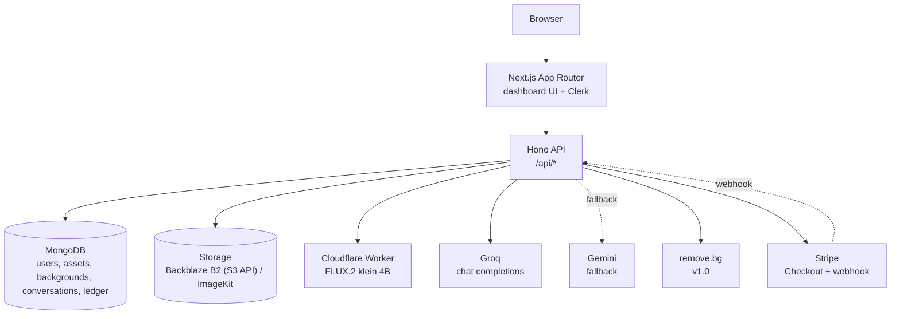

# Vision

An AI creative studio that puts image generation, background removal, and conversation in one workspace. Built as a full-stack Next.js application with a Hono API, MongoDB persistence, Clerk authentication, and Stripe billing.


Deployed preview: [vision-steel-pi.vercel.app](https://vision-steel-pi.vercel.app) (Clerk-protected; the deployment may lag the default branch).

## Demo

A 90-second walkthrough of the shipped flows. The table below is the shot list;
once the recording is uploaded, add `▶ [Watch the demo](URL)` at the top of this
section.

| Time | Screen | What to show |
| --- | --- | --- |
| 0:00 | Dashboard | Signed-in dashboard: plan, credit balance, 7-day activity, recent assets |
| 0:10 | Generate | Choose a prompt example and a ratio tile, generate 1–2 images, show the credit cost and result gallery |
| 0:35 | Background Studio | Upload a product photo, compare the cutout against the original, keep the source |
| 0:55 | Conversation | Ask a question, show the reply, rename the session |
| 1:10 | Billing | Open `/billing`, show the plan cards, and hand off to Stripe Checkout in test mode |

> **Video link:** _pending the recording._ Replace this line with
> `▶ [Watch the demo](URL)` when the video is uploaded.

## Status at a glance

| Surface | State today |
| --- | --- |
| Dashboard | Generation entry points, credit usage, plan, and recent activity |
| Image generation | Cloudflare Workers AI FLUX.2 [klein] 4B through a Worker or the API directly, 1–2 images per request, private storage; prompt examples, ratio tiles, cost label, retryable error states |
| Theming | Light, dark, and system toggle in the navbar (`next-themes`, token-driven) |
| Conversation | Groq `openai/gpt-oss-120b` with Gemini `gemini-3.6-flash` fallback, 60 s timeout and 3 bounded retries; request/response (no streaming) |
| Background removal | remove.bg `removebg-v1` (preview by default, full resolution uses credits), transparent PNG, original kept for comparison; a labelled local mock runs when no background key is present outside production |
| Video generation | Not available — no provider is configured or integrated |
| Plans | Free (5 credits over a 7-day trial), Basic ($9/mo, 100 credits), Pro ($29/mo, 500 credits) |
| Credits | One credit per image request, chat reply, or cutout; failed requests are refunded |
| Upgrade flow | Stripe Checkout, a server-side Basic↔Pro price swap, and a portal cancellation deep link that returns to the dashboard; signed webhooks flip the plan and refill credits. A dialog prompts when the trial ends or credits run out |

Each generation request consumes one quota unit (an image request for two images is still one unit). Without real provider keys the app runs in **mock mode** locally so every screen can be exercised end to end.

## Architecture



A generation request flows through: Clerk session → Zod validation → quota reservation → provider call → object storage → asset metadata in MongoDB → quota settlement. Provider failures refund the reservation; a replayed idempotency key returns `409 DUPLICATE_REQUEST` instead of charging again.

## Quick start

Prerequisites: Node.js 20+ (or Bun 1.4+), Docker for the local database, and a Clerk application.

```bash
git clone https://github.com/ni3420/vision.git
cd vision
bun install

cp .env.example .env.local
# edit .env.local: Clerk keys and APP_URL
# DB_URL already points at the compose service

docker compose up -d      # MongoDB 7 on 127.0.0.1:27017
bun run dev
```

`docker compose down` stops the database and keeps its data in the `mongo-data` volume; add `-v` to delete the data too. The service is bound to `127.0.0.1` only, so it is not exposed to the network.

Open `http://localhost:3000`, sign up, and generate an image. The dashboard's `UserSync` component creates the MongoDB user on first load; quota checks need that record.

### Environment variables

The complete list with comments lives in [`.env.example`](.env.example).

| Group | Variables | Needed |
| --- | --- | --- |
| Database | `DB_URL` | Always |
| Auth | `NEXT_PUBLIC_CLERK_PUBLISHABLE_KEY`, `CLERK_SECRET_KEY` | Always |
| App | `APP_URL` | Production (Stripe redirects; dev uses the request origin) |
| Runtime mode | `AI_MODE` (`auto` \| `live` \| `mock`) | Optional, defaults to `auto` |
| Image provider | `CLOUDFARE_URL` + `CLOUDFARE_API_KEY` (your own Worker), or `CLOUDFLARE_ACCOUNT_ID` + `CLOUDFLARE_API_TOKEN` (direct) | For live images |
| Chat provider | `GROQ_API_KEY`, `GROQ_MODEL`, `GEMINI_API_KEY`, `GEMINI_MODEL` | For live chat |
| Background provider | `REMOVE_BG_API_KEY` (default), `BACKGROUND_PROVIDER`, `PHOTOROOM_API_KEY` (fallback) | For live background removal |
| Storage | `STORAGE_DRIVER` (`s3` \| `imagekit` \| `local`), `LOCAL_STORAGE_DIR`, `S3_*`, `IMAGEKIT_URL_ENDPOINT`, `IMAGEKIT_PUBLIC_KEY`, `IMAGEKIT_PRIVATE_KEY`, `IMAGEKIT_PRIVATE_FILES` | Backblaze B2 (`s3`) in this repo's `.env.local`; `local` is dev-only |
| Billing | `STRIPE_SECRET_KEY`, `STRIPE_BASIC_PRICE_ID`, `STRIPE_PRO_PRICE_ID`, `STRIPE_WEBHOOK_SECRET` | For checkout |

### Mock mode

`AI_MODE=auto` (default) calls a provider when its key looks real; otherwise it renders a local mock outside production. Mock output is visibly labelled in the UI (`Local mock preview`, `[dev mock reply]`) and is never presented as real output. The mocks are:

- **Image** — a locally rendered gradient card with the prompt, resized with `sharp`.
- **Chat** — a canned reply that repeats the prompt.
- **Background** — a locally masked placeholder PNG with a visible label, so the comparison UI and alpha channel can be exercised without spending remove.bg credits.

In production, missing keys resolve to `live` and return `503 PROVIDER_NOT_CONFIGURED` instead of silently faking output.

**Images never fall back to a mock on their own.** With `AI_MODE=auto` and no image provider key, `POST /api/image/generate` returns `503 PROVIDER_NOT_CONFIGURED`; set `CLOUDFARE_URL` and `CLOUDFARE_API_KEY` for cloud generation. The gradient preview exists only when `AI_MODE=mock` is set explicitly (as `bun run smoke` does).

### Storage

Generated images, background uploads, and cutouts are written to **Backblaze B2** through its S3-compatible API. This repo's `.env.local` sets `STORAGE_DRIVER=s3`, and the endpoint is accepted with or without a scheme (a bare `s3.<region>.backblazeb2.com` gets `https://` prepended).

- `STORAGE_DRIVER=s3` works with Backblaze B2, AWS S3, and Cloudflare R2 (`S3_ENDPOINT`, `S3_REGION`, `S3_ACCESS_KEY_ID`, `S3_SECRET_ACCESS_KEY`); reads return short-lived presigned URLs.
- `STORAGE_DRIVER=imagekit` uploads server-side to ImageKit and stores the durable CDN URL on the asset, so history never depends on a URL that expires. Set `IMAGEKIT_PRIVATE_FILES=true` to upload private files, which are served with signed `ik-t`/`ik-s` URLs instead.
- `STORAGE_DRIVER=local` writes to `.data/uploads` (git-ignored) and serves files from `GET /api/assets/:key`, which requires the owning Clerk session. Use it only for offline development; `bun run smoke` forces it so the adapter check never touches the bucket.

Object keys are opaque (`users/<userId>/<kind>/<yyyy>/<mm>/<uuid>.<ext>`) and ownership is re-checked on every read. Generated images are stored with their URL in `assets.url`; presigned or signed URLs are never persisted.

Image provider calls retry up to 3 times with exponential backoff on network errors and `408`/`429`/`5xx`; `Retry-After` is honoured. A failed request returns `retryable` in the error body so the UI can offer a retry. Requests are `multipart/form-data` with `prompt`, `width`, and `height`, because FLUX.2 klein takes multipart and a fixed 4-step schedule (no `steps` field).

### Cloudflare Worker for images

`worker/` runs FLUX.2 [klein] 4B through the `AI` binding (`Image-AI`). Deploy it once and keep the Cloudflare token out of the Next.js app:

```bash
cd worker
bunx wrangler login                        # your account, your browser
bunx wrangler secret put IMAGE_API_TOKEN   # the shared secret
cd ..
bun run worker:deploy                      # prints https://vision-image-worker.<subdomain>.workers.dev
```

Then set `CLOUDFARE_URL` to that URL and `CLOUDFARE_API_KEY` to the same secret. For local work: `cp worker/.dev.vars.example worker/.dev.vars`, fill it in, run `bun run worker:dev`, and use `CLOUDFARE_URL=http://localhost:8787`.

The Worker accepts `POST /generate` with JSON `{ prompt, width?, height?, aspectRatio?, guidance?, seed? }` or a multipart form (optionally with an `image` field for image-to-image). It returns raw image bytes, exposes `GET /health`, and answers CORS preflight. It returns `503` until `IMAGE_API_TOKEN` is set, so a fresh deploy is never an open proxy. An already-deployed Worker with an `IMAGE_API_TOKEN` secret works unchanged — only the request format matters.

### Stripe billing

Plans live in `src/lib/plans.ts` and must match two recurring monthly prices in Stripe:

| Plan | Price | Credits each month |
| --- | --- | --- |
| Basic | $9 | 100 |
| Pro | $29 | 500 |

1. Create both recurring prices and set `STRIPE_BASIC_PRICE_ID` and `STRIPE_PRO_PRICE_ID`.
2. Add a webhook endpoint at `<app>/api/billing/webhook` (locally: `stripe listen --forward-to localhost:3000/api/billing/webhook`) and set `STRIPE_WEBHOOK_SECRET`.
3. Checkout creates or reuses a Stripe customer and stores `stripeCustomerId`; paid users manage cards and cancellation through the Billing Portal at `/billing`.

Plan buttons are plan-aware: a free user sees `Choose Basic/Pro` (Checkout), while an existing subscriber sees `Upgrade to Pro` or `Switch to Basic`. Paid-to-paid changes go through `POST /api/billing/change-plan`, which swaps the subscription price server-side with proration because the default Billing Portal configuration disables plan updates. `Downgrade to Free` opens the portal's cancellation flow through a deep link, and Stripe's `after_completion.redirect` returns the browser to the dashboard. `GET /api/auth/current` reports `canManageSubscription` (backed by a stored `stripeSubscriptionId`); a paid plan without one — for example a manually granted plan — disables those buttons and explains why.

The webhook handles `checkout.session.completed`, `customer.subscription.created|updated|deleted`, `invoice.paid`, and `invoice.payment_failed`. Event IDs are persisted in `stripe_events`, so a duplicate delivery is acknowledged without being applied twice; a failed handler removes the marker so Stripe's retry can run again.

Free accounts get 5 credits for 7 days. Paid credits refill every 30 days and on `invoice.paid`. While a price or key is missing, checkout and portal return `503 BILLING_NOT_CONFIGURED` and the UI labels the paid plans `Not available yet` rather than failing silently.

`/api/billing/webhook` is the only API route outside Clerk protection; its Stripe signature is verified before any database write.

## Scripts

| Command | What it does |
| --- | --- |
| `bun run dev` | Next.js dev server (Turbopack) |
| `bun run build` | Production build |
| `bun run start` | Serve the production build |
| `bun run typecheck` | `tsc --noEmit` |
| `bun run lint` | ESLint |
| `bun run test` | Unit tests (Bun runner): quota, rate limiting, dashboard summary, image schemas, generation error copy, AI mode resolution |
| `bun run smoke` | Adapter smoke test; forces `AI_MODE=mock` and verifies JPEG bytes, resizing, chat text, a transparent cutout PNG, and a storage round-trip |

### Continuous integration

[`.github/workflows/ci.yml`](.github/workflows/ci.yml) runs on every push to `main` and on every pull request. The `verify` job installs with `--frozen-lockfile` on Bun 1.4.2, then runs typecheck, lint, the unit suite, and the adapter smoke test. The `build` job runs only after `verify` passes and produces a production build with placeholder Clerk and Mongo values, so CI never needs real secrets.

## API

All routes are mounted under `/api` and require a Clerk session unless noted. Mutating generation routes accept an `Idempotency-Key` header.

| Method | Route | Purpose |
| --- | --- | --- |
| `POST` | `/api/auth` | Upsert the signed-in user and return the MongoDB record |
| `GET` | `/api/auth/current` | Current user (plan, credits, trial dates) |
| `POST` | `/api/image` | Generate 1–2 images (`prompt`, `dimensions`, `quantity`) |
| `GET` | `/api/image/history` | 60 newest image assets |
| `POST` | `/api/background` | Remove the background (`multipart/form-data`, field `image`; PNG/JPEG/WebP up to 10 MB) |
| `GET` | `/api/background/history` | 30 newest cutouts with fresh source and result URLs |
| `POST` | `/api/conversation/session` | Create a conversation (optionally with a first message; the server generates the id) |
| `POST` | `/api/conversation/message` | Append a user message and get the reply |
| `GET` | `/api/conversation/all` | Session summaries (title, message count, preview, last message time); `?limit=` 1–100 |
| `GET` | `/api/conversation/:sessionId` | One conversation |
| `PATCH` | `/api/conversation/:sessionId` | Rename a conversation (`title`, 1–80 chars) |
| `DELETE` | `/api/conversation/:sessionId` | Delete a conversation |
| `GET` | `/api/dashboard/summary` | Counts, 7-day activity series, plan, credits, and trial state |
| `GET` | `/api/assets/:key` | Owner-only local asset read |
| `GET` | `/api/billing/plans` | Plan catalog plus which plans have a configured Stripe price |
| `POST` | `/api/billing/checkout` | Create a Checkout session for `BASIC` or `PRO` |
| `POST` | `/api/billing/change-plan` | Switch an existing Stripe subscription between `BASIC` and `PRO` |
| `POST` | `/api/billing/portal` | Create a Billing Portal session for the stored customer; `{ flow: "cancel" }` uses Stripe's cancellation deep link with an automatic redirect back to the dashboard |
| `POST` | `/api/billing/webhook` | Stripe events (public, signature-verified, idempotent) |

Stable error codes include `TRIAL_EXPIRED` (403), `QUOTA_EXCEEDED` (403), `USER_NOT_INITIALIZED` (404), `DUPLICATE_REQUEST` (409), `ALREADY_SUBSCRIBED` (409), `RATE_LIMITED` (429), `PROVIDER_NOT_CONFIGURED` (503), `STORAGE_NOT_CONFIGURED` (503), `BILLING_NOT_CONFIGURED` (503), `PROVIDER_CALL_FAILED` (502), and `STORAGE_WRITE_FAILED` (502). Provider and storage failures include `retryable`.

### Request limits

- Prompt: 3–1000 characters.
- Dimensions: 64–1536 px per side, `WIDTH*HEIGHT` format.
- Quantity: 1–2 images per request.
- Conversation messages: 4000 characters server-side; only the last 12 turns are sent to the model.
- Background uploads: PNG, JPEG, or WebP; file signature must match the declared type; 10 MB maximum.
- Rate limits per user, per route (fixed one-minute window): image 10, background 10, conversation message 30, billing checkout/plan-change/portal 10. Every response carries `X-RateLimit-Limit`, `X-RateLimit-Remaining`, and `X-RateLimit-Reset`; a `429` adds `Retry-After`.

## Data model

| Collection | Holds |
| --- | --- |
| `users` | Clerk `userId`, email, name, plan, trial end, credits, reset date, Stripe customer/subscription IDs |
| `assets` | Image metadata: object key, MIME, bytes, dimensions, prompt, provider, model |
| `backgrounds` | Source and cutout object keys, MIME, bytes, dimensions, provider, model, quality (`preview`/`full`), mock flag |
| `usage_ledger` | Reservation records with a unique sparse idempotency key |
| `rate_limits` | Per-user, per-route window counters; a TTL index expires them |
| `stripe_events` | Processed Stripe event IDs for webhook idempotency |
| `conversations` | Session metadata and message history |

## Known limitations

- **Video** is not implemented. No free, production-ready text-to-video API is wired in, so the page is a placeholder rather than a dead button.
- **Tests** cover quota semantics, rate-limit windows, retry/backoff, ImageKit signing and upload, pure dashboard logic, image and conversation schemas, chat/generation error copy, grouping and relative-time helpers, and AI mode resolution. There is no browser E2E suite or database-backed integration test yet; CI covers typecheck, lint, unit tests, the adapter smoke test, and a production build.
- **Background removal** calls remove.bg v1.0 (Photoroom remains an explicit fallback via `BACKGROUND_PROVIDER`). A live preview call succeeded on 2026-11-02: a 512×512 JPEG produced a 500×500 RGBA PNG, 91.3% fully transparent, in ~4.3 s. Full-resolution output consumes remove.bg credits and has not been exercised. Without any background key outside production the route returns a visibly labelled local mock.
- **UI verification** was a signed-in browser pass on 2026-11-02 covering `/`, `/billing`, `/image-generator`, Background Studio, and conversation, backed by typecheck, lint, and a production build. There is no automated browser E2E suite yet.
- **Chat** was exercised end to end against Groq `openai/gpt-oss-120b` on 2026-11-02: replies persisted and one credit was charged per reply. The Gemini `gemini-3.6-flash` fallback is implemented, but the local Gemini key is an OAuth-style token that Google rejects with `400 API_KEY_INVALID`, so only the primary path has run. Chat is request/response — no streaming, stop button, or token usage.
- **Rate limiting** covers generation, conversation messages, and billing actions; auth, creating an empty session, and history reads are unmetered. The limiter fails open if MongoDB is unreachable. A session created with a first message is rate limited.
- **Billing** was exercised in Stripe test mode on 2026-11-02: Checkout, Basic↔Pro price swaps, portal access, cancellation, the post-cancel redirect to the dashboard, and a `customer.subscription.deleted` webhook that downgraded the user. It has not run against live-mode Stripe. Because `cancel_at_period_end` reads false on API `2026-06-24.dahlia`, a subscription scheduled to cancel still looks active on `/billing` until the period ends.
- **Credit refill** is lazy: a paid allowance refills on the next quota check after 30 days, and `invoice.paid` can refill sooner. There is no scheduled job.
- The free-quota path has not been exercised against a live MongoDB here; unit tests mock the models and the HTTP flow is statically verified only.
- History endpoints return the newest 60 images / 30 cutouts; cursor pagination is not implemented.

## Roadmap

1. Per-route metadata, Open Graph tags, and an OG image.
2. Rate limits on auth and session creation, and segment-level error boundaries.
3. Browser E2E tests against a seeded database, then an end-to-end demo dry run.
4. Image editing (background removal, inpainting) behind verified providers.
5. Video only after image workflows and unit economics are validated.

The full product direction lives in [AGENTS.md](AGENTS.md).

## Contributing

```bash
git checkout -b feature/your-feature
bun run typecheck && bun run lint && bun run test && bun run smoke
bun run build
```

Then open a pull request against `main`. Keep changes small and include the commands you ran.

## Contributors

<a href="https://github.com/ni3420" title="ni3420"></a>

[See the full list of contributors](https://github.com/ni3420/vision/graphs/contributors)
